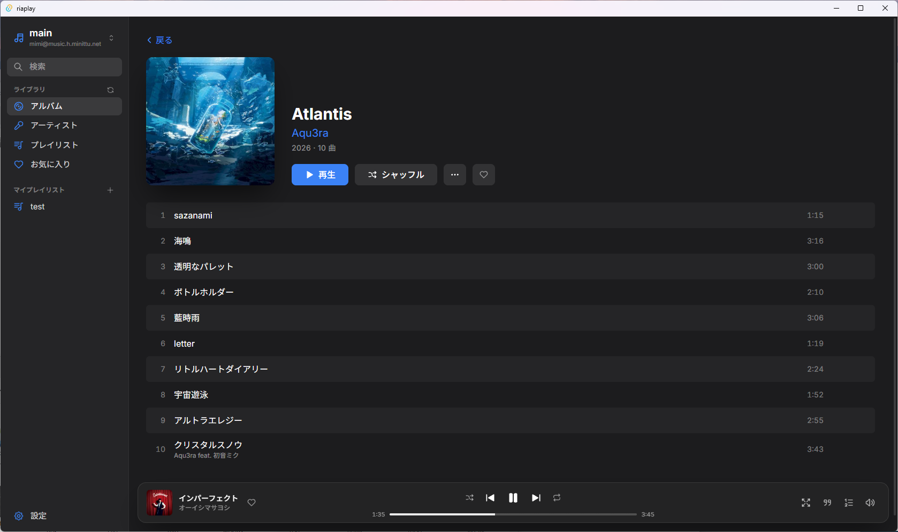
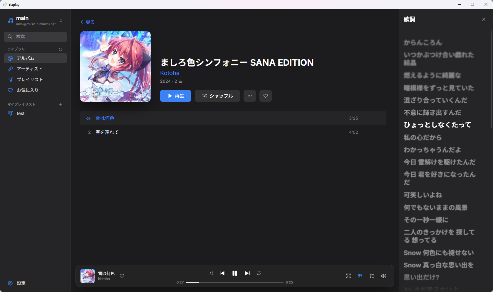

# riaplay

Navidrome用のデスクトップ音楽プレイヤーです。Tauri 2、Vue 3、libmpvで作っています。

## 画面

歌詞は右のパネルに出ます。同期歌詞では、いま歌っている行が浮き上がり、遠い行ほどぼけます。

プレイヤーバーの拡大ボタンかジャケットをクリックすると、ウィンドウいっぱいの再生中画面になります。ジャケットにマウスを載せると、再生や音量などの操作が重なって出ます。

## 機能

- サーバーは何台でも登録して切り替えられます。パスワードはOSのキーチェーンに保存します。
- アルバム、アーティスト、プレイリスト、お気に入りの一覧と検索があります。設定で自動更新の間隔も選べます。
- 右クリックメニューから、次に再生、キューへの追加、プレイリストへの追加ができます。キューはドラッグで並べ替えます。
- 曲をダウンロードして、オフラインで聴けます。サーバーに繋がらなくても、ダウンロード済みの曲でアプリが開きます。
- 設定で最大ビットレートを選べます。原音以外はサーバーで変換されます。
- OSのメディアキーに対応しています。LinuxはMPRIS、WindowsはSMTC、macOSはNow Playingです。
- DiscordのRich Presenceに対応しています。ジャケット画像は、アーティスト名とアルバム名で公開API(iTunes Search、Deezer、MusicBrainz)から探します。
- ListenBrainzでのScrobblingに対応しています。

DiscordとListenBrainzは、どちらも設定でオンにすると使えます(初期値はオフ)。

### 歌詞

サーバー(OpenSubsonicの歌詞に対応している場合)、[LRCLIB](https://lrclib.net)、NetEase Cloud Musicの順に探します。LRCLIBとNetEase Cloud Musicには、曲名、アーティスト名、アルバム名、再生時間が送られます。送りたくなければ、設定の「歌詞を取得する」をオフにします。

取得した歌詞は端末に保存します。見つからなかった曲は7日後に探し直します。

## 使い方

[Releases](https://github.com/minittupoyo/riaplay/releases)からインストーラーを入れます。初回起動でサーバーのURL、ユーザー名、パスワードを入れます。

## 開発

ビルドやリリースの手順は[DEVELOPMENT.md](DEVELOPMENT.md)にあります。

## ライセンス

[MIT](LICENSE)
