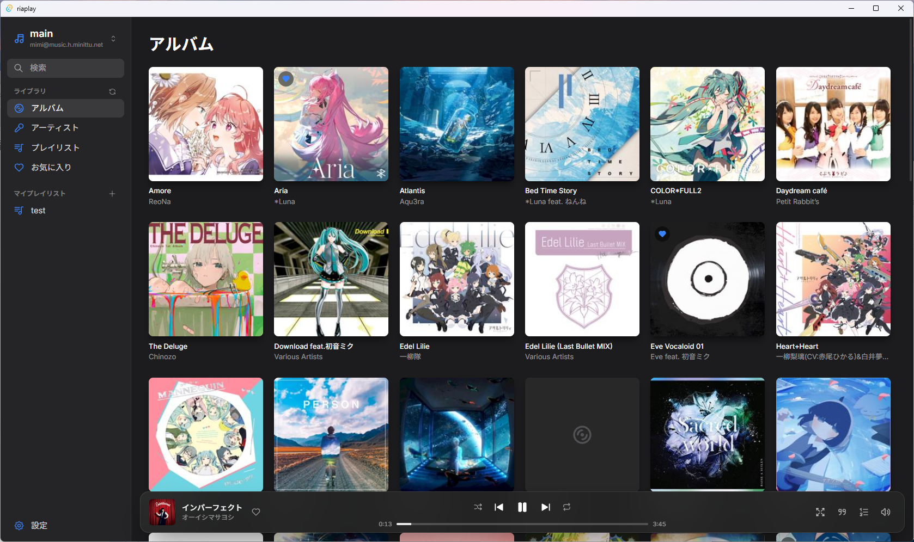
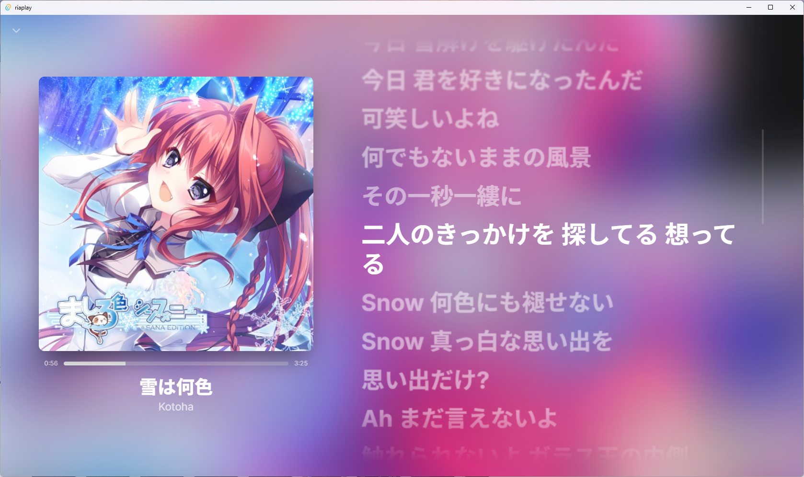

# riaplay

Navidrome 向けのデスクトップ音楽プレイヤーです。Tauri 2 と Vue 3 で書いていて、音声は libmpv で鳴らします。



## 画面

アルバムを開くと曲の一覧が出ます。再生中の曲には、行の左にスピーカーのアイコンが付きます。


歌詞は右のパネルに出ます。同期歌詞なら、いま歌っている行が白く浮き上がり、遠い行ほどぼけます。


プレイヤーバーの拡大ボタン、またはジャケットをクリックすると、ウィンドウいっぱいの再生中画面に切り替わります。背景にはジャケットの色が広がります。シークバーと曲名だけを出していて、ジャケットにマウスを載せると、再生、前後の曲、シャッフル、リピート、音量、お気に入りが重なって現れます。



## 機能

サーバーは何台でも登録して切り替えられます。パスワードは OS のキーチェーンに保存します。追加するときに「パスワードを保存する」のチェックを外すと、起動している間だけメモリに持ち、次の起動でまた聞かれます。

ライブラリはアルバム、アーティスト、プレイリスト、お気に入りで分かれていて、検索もあります。サイドバーの更新ボタンで読み込み直し、設定で 5 分から 60 分の間隔を選べば自動で更新します。

曲・アルバム・プレイリストの行やカードを右クリックすると、再生、次に再生、キューへの追加、プレイリストへの追加が出ます。キューはドラッグで並べ替えます。

ストリーミング品質は、設定で最大ビットレートを選びます。原音以外を選ぶと、サーバー側で変換した音が届きます。再生中のコーデック、サンプルレート、ビットレートはプレイヤーバーの「i」ボタンで確認します。このボタンは設定の「詳細情報を表示」をオンにしたときだけ出ます。

OS のメディアキーとメディアコントロールにつながっています。Linux は MPRIS、Windows は SMTC、macOS は Now Playing です。

### 歌詞

歌詞は、サーバー（OpenSubsonic の歌詞に対応している場合）、[LRCLIB](https://lrclib.net)、NetEase Cloud Music の順に探します。同期歌詞が見つかった時点で止まります。LRCLIB と NetEase Cloud Music には、曲名、アーティスト名、アルバム名、再生時間が送られます。気になる場合は、設定の「歌詞を取得する」をオフにしてください。

一度取った歌詞は端末の IndexedDB に残るので、次からは問い合わせません。見つからなかった曲は 7 日後に探し直します。保存した歌詞は、設定の「歌詞のキャッシュ」から消せます。

## 使い方

初回起動で、サーバーの URL、ユーザー名、パスワードを入れます。以降は起動すると、そのまま前回のサーバーにつながります。

## ビルド

Bun と Rust 1.85 以降が要ります。[Tauri の前提パッケージ](https://tauri.app/start/prerequisites/)も入れておいてください。

```sh
bun install
bun run tauri dev     # 開発用に起動
bun run tauri build   # インストーラーを作る
```

libmpv はプラットフォームごとに用意の仕方が違います。

**Windows** では、先に libmpv の DLL とインポートライブラリを取ってきます。

```powershell
powershell -ExecutionPolicy Bypass -File scripts/fetch-libmpv.ps1
```

`src-tauri/libs/windows/` に置かれ、ビルドで実行ファイルの隣に同梱されます。

**Linux** は、開発用パッケージを入れます。libmpv は新しめの client API が要るので、CI は Ubuntu 24.04 でビルドしています。

```sh
sudo apt-get install libwebkit2gtk-4.1-dev libgtk-3-dev libayatana-appindicator3-dev \
  librsvg2-dev libssl-dev libdbus-1-dev libmpv-dev patchelf rpm
```

**macOS** は `brew install mpv` でコンパイルできます。libmpv を `.app` に入れる設定がまだないため、配布用のバンドルは作れません。

同梱の詳細は [src-tauri/libs/README.md](src-tauri/libs/README.md) にあります。

### テスト

```sh
cargo test --manifest-path src-tauri/Cargo.toml
```

キーチェーンの保存と取得を実機の OS で確かめるテストを含みます。Linux の CI では Secret Service がないので、このテストだけ飛ばしています。

## ライセンス

[MIT](LICENSE)
